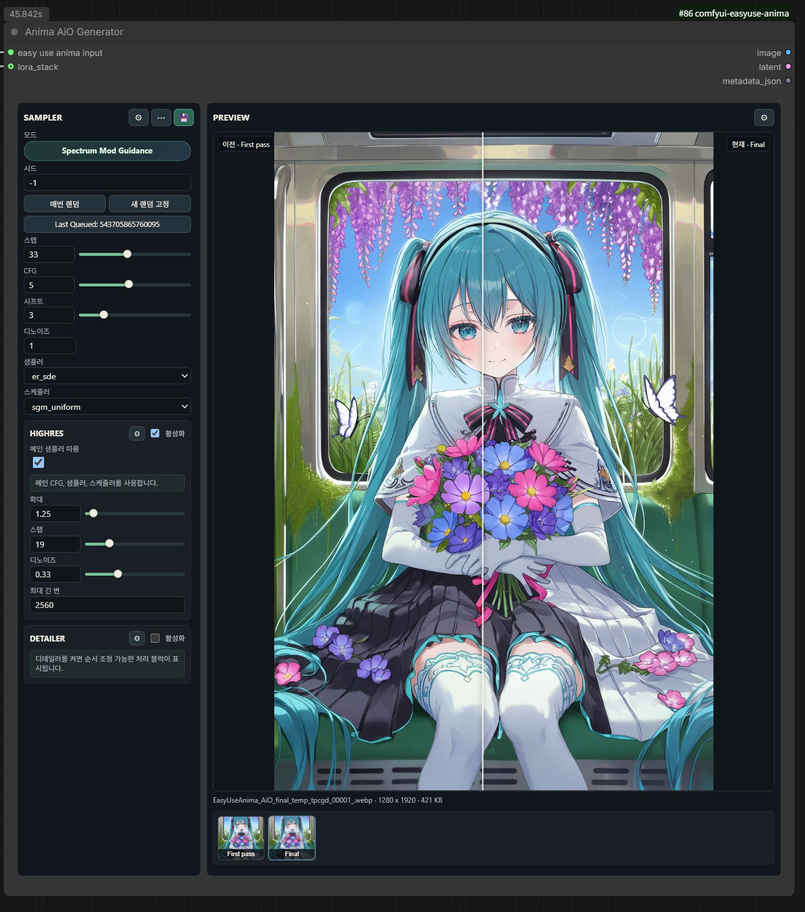

# AiO Generator (Anima / MOSS / Krea2)

`AiO Generator (Anima)`, `AiO Generator (MOSS)`, `AiO Generator (Krea2)`는
각각 고정된 모델용 노드입니다. 내부 생성·seed·저장 구조는 공유하지만 설정은
노드별로 독립적입니다. 기존 Anima 노드 ID와 워크플로우는 유지됩니다.
이전 MOSS 개발판 워크플로우는 생성 노드를 MOSS 노드로 교체하고 기존
`generation_settings`를 그대로 옮기세요. 계열이 다른 프로필은 적용할 수 없습니다.

MOSS는 ComfyUI 코어 지원 빌드(검증 기준 v0.42.1)가 필요합니다. Input에서 MOSS
diffusion model, Qwen3.5 9B text encoder, CLIP type `moss_image`, FLUX.2 VAE를
선택하세요. 기본값은 25 steps / CFG 2.5 / er_sde / simple / shift 5입니다.
해상도 가로·세로는 16의 배수여야 하며 모델 선택만으로 파일을 자동 변경하거나 다운로드하지 않습니다.

Krea2는 Input에서 Krea2 diffusion model, Qwen3-VL 4B encoder, CLIP type `krea2`,
`qwen_image_vae.safetensors`를 선택하세요. Turbo 기본값은 8 steps / CFG 1 /
Euler / simple / shift 1.15이며 16배수 해상도를 사용합니다. shift는 Krea2의
FLUX mu로 적용됩니다. RAW 모델은 별도의 steps·CFG·shift 설정이 필요합니다.
[공식 Krea2 가이드](https://docs.comfy.org/tutorials/image/krea/krea-2)

MOSS/Krea2는 txt2img, 코어 LoRA 로딩, Artist Mix, Highres, SAM3 Detailer,
USDU/ResShift Upscale, KJ SageAttention·FP16 accumulation,
일반 AiO hook, 미리보기·후처리·저장을 지원합니다. 선택 기능의 외부 노드와
로컬 모델은 별도로 필요합니다. Anima IP-Adapter hook은 Anima 전용입니다.
Torch Compile은 세 모델에서 KJ 제공자를 선택할 수 있고, Anima에서는
Anima Block Compile도 선택할 수 있습니다. 컴파일은 기본 off이며 저장된 튜닝은 유지합니다.
ComfyUI v0.42.1의 MOSS INT8/ConvRot attention·fused-linear 커널은 Spectrum을 꺼도
Inductor 컴파일에 실패한 사례가 있습니다. 설치 가능 여부와 실제 체크포인트 컴파일 성공은
별개이며 AiO가 컴파일이나 attention 설정을 자동 변경하지 않습니다.
최신 ComfyUI-Anima-DAVE의 MOSS 마스크를 사용하면 MOSS DAVE도 연결됩니다.
새 DAVE 기본값은 auto 마스크·strength 0.3·tau 0.06이며 기존 명시값은 보존합니다.
MOSS NegPip은 네이티브 MOSS를 지원하는 ComfyUI-ppm이 필요하며, 실제 MODEL·CLIP
패치가 적용됐는지 확인합니다. Krea2 NegPip은 아직 지원하지 않습니다.
MOSS와 Krea2의 Spectrum 예측 가속은 설치된 제공자가 해당 단계를 지원할 때
최초 생성·Highres·Detailer·USDU 샘플링에서 사용할 수 있습니다. AiO는 모델,
로더, 계약 버전, 기능과 입력을 확인한 뒤 공개 노드인 `SpectrumMossModelPatch` /
`SpectrumKrea2ModelPatch`를 호출합니다. 정식 ID가 없을 때는 기존
`NativeMossSpectrumPatch` / `NativeKrea2SpectrumPatch` 별칭을 사용합니다.
정식 제공자가 호환되지 않으면 이전 별칭으로 우회하지 않습니다. 예측 구현은
Spectrum이 소유하며 AiO에 복제하지 않습니다.

두 패치는 ComfyUI 기본 로더용입니다. 별도 로더용 `MossSpectrumKSampler`만으로는
이 계약을 충족하지 않습니다. 각 crop·tile은 새 예측 상태로 시작하며, 제공자가
없거나 호환되지 않으면 미지원 설정을 비활성화하고 저장값은 유지합니다.
MOSS와 공통 기반은 [Spectrum PR #11](https://github.com/sorryhyun/ComfyUI-Spectrum-KSampler/pull/11),
Krea2는 이에 의존하는 [Spectrum PR #12](https://github.com/sorryhyun/ComfyUI-Spectrum-KSampler/pull/12)로
제안합니다. 개발 중인 연동이며 upstream
배포판에 이미 포함됐다는 의미는 아닙니다.

Krea2 패치는 RAW와 Turbo가 공유하는 모델 구조를 대상으로 하며, 파일명으로
종류를 추정하거나 8스텝·CFG 1을 강제하지 않습니다.
[공식 RAW 예시](https://huggingface.co/krea/Krea-2-Raw)는 52스텝·`--cfg 3.5`를 사용합니다.
공식 코드의 guidance 정의는 Comfy CFG와 달라 이 값은 Comfy CFG **4.5**에 해당합니다.
[공식 샘플러 계산식](https://github.com/krea-ai/krea-2/blob/main/sampling.py)을 참고하세요.
사용하는 체크포인트에 맞게 steps·CFG·flow shift를 설정하면 Spectrum은 실제
스케줄을 따릅니다. 실체크포인트 검증은 현재 Turbo INT8에 한정되며 RAW 가중치의
출력 품질과 속도는 검증하지 않았습니다.

Krea2 예측 가속은 실험적입니다. 새 Turbo 설정은 degree 1, history 8,
warmup 3, tail 2를 사용합니다. 기존 저장값은 유지하므로 warmup 6·tail 3인
8스텝 워크플로우에는 예측 구간이 없을 수 있습니다. Spectrum을 끈 결과와
품질을 비교하세요. 참조 이미지·다중 프레임·미지원 출력 헤드 양자화는 전체 계산으로 돌아갑니다.
두 모델의 Anima Mod Guidance·Safe PAG·DiT 보정, Krea2 DAVE,
Advanced/SPD 샘플러 백엔드는 아직 지원하지 않습니다. 예측 가속 지원만으로
이 기능들이 활성화되지는 않습니다. 기존 Anima Spectrum 지원은 유지됩니다.

## MOSS 전용 설정

Advanced Options의 **MOSS 모델 기능**에서 다음 기능을 선택합니다. 기본값은
SLG off와 원문 사용이므로 기존 워크플로우의 입력을 자동으로 확장하지 않습니다.

- **SLG**: Uncond는 네거티브 분기를, Standard는 추가 예측을 사용합니다.
  기본 레이어는 22이며 적용 구간과 최초 생성·Highres·Detailer·USDU를 따로 선택합니다.
  Uncond에는 네거티브 분기가 필요합니다(CFG 1에서는 보통 생략됩니다).
  Standard의 공식 권장 구간은 0.01–1입니다.
- **프롬프트 확장**: 이미 선택한 MOSS 텍스트 인코더로 Comfy `TextGenerate`를 실행합니다.
  추가 추론 시간이 들며, 시드·출력 길이·샘플링 설정을 지정할 수 있습니다.
  입력과 실제 생성에 사용한 문장을 실행 메타데이터에 기록합니다.
- **Layout JSON**: 공식 `summary`/`items` 구조를 붙여 넣습니다. 빈칸이면 입력 prompt의
  JSON을 사용합니다. 기존 `MOSSImageLayoutPrompt` 노드의 문자열 출력도 이용할 수 있습니다.
  박스 좌표는 생성 캔버스 중심 기준 픽셀이므로 작성한 레이아웃과 최초 생성 해상도를 맞추세요.
  원문 모드에 직접 입력한 Layout JSON도 보존합니다. Layout은 NegPip off,
  Layout·확장 모드는 Artist Mix off가 필요하며 충돌 시 값 변경 없이 안내합니다.

MOSS 자연어의 개행·인용문과 JSON은 Anima 태그 정리로 재작성하지 않습니다.
모델의 공식 긴 프롬프트 지원은 최대 4K 토큰이며, 확장 노드의 출력 길이 상한과는 다릅니다.
참조 이미지 생성·GIF 등 향후 모델 기능은 현재 지원으로 표시하지 않습니다.
[MOSS 공식 기능·Layout 가이드](https://github.com/OpenMOSS/MOSS-Image/blob/main/USERGUIDE.md)

카테고리: `EasyUse Anima/AiO`

`AiO Generator (Anima)`는 `Easy Use Anima Input`에서 전달받은 전용 context를
사용해 프롬프트 인코딩, 1차 샘플링, 선택적 Highres, 선택적 Detailer, 이미지
저장을 한 노드에서 실행합니다. Prompt Studio에서 만든 prompt data는 upstream에서
처리되므로 이 노드 UI에는 프롬프트 편집 항목이 없습니다.

## 기본 연결

1. `Anima 프롬프트 스튜디오 고급 v2`의 prompt data를 `Easy Use Anima Input`에 연결합니다.
2. `Easy Use Anima Input`에서 ANIMA diffusion model, VAE, CLIP을 각각 선택합니다.
3. `Easy Use Anima Input` 출력을 `AiO Generator (Anima)`의 `easy use anima input`에 연결합니다.
4. 필요하면 `Anima LoRA Preset`의 `LORA_STACK`을 `lora_stack`에 연결합니다.
5. 다른 노드팩의 AiO 확장을 쓸 때만 `EASYUSE_ANIMA_AIO_HOOK` 출력을
   `aio_hook`에 연결합니다. 여러 hook은 `Anima AiO Hook Combine`으로 합칩니다.

## 확장 hook

`aio_hook`은 연결하지 않아도 기존 생성과 저장 동작이 그대로 유지되는 선택
입력입니다. 현재 v1은 `first_pass/before`의 MODEL·sampler allowlist patch와 최종
postprocess의 before/after callback, 같은 shape의 `IMAGE`, 확장 metadata, 선택적
preview를 공개합니다. postprocess hook으로 바뀐 `IMAGE`는 Generator의 `LATENT`와
일치하도록 다시 인코딩되지 않습니다.

직접 hook 노드를 만들려면 [AiO Hook API v1 개발 가이드](../extensions/aio-hooks.ko.md)와
[복사 가능한 예제](../../examples/third_party_aio_hook/)를 참고하세요.

## 생성 프로필

`SAMPLER` 헤더의 프로필 버튼은 생성 설정 전체 스냅샷을 적용합니다.

- `일반`은 현재 기본값을 유지하고 선택적인 Spectrum/DCW 및 KJ 실행 최적화를
  모두 끕니다.
- `터보`는 `steps=10`, `CFG=1`, `er_sde`, `simple`을 사용합니다.
- `최적화`는 모든 샘플링 단계의 Spectrum/DCW와 권장 KJ FP16 accumulation,
  SageAttention, Sage compile, Torch Compile 값을 활성화합니다. DAVE와 Safe
  PAG는 별도 선택 기능이므로 꺼진 상태를 유지합니다.

현재 설정이 기본 프로필과 정확히 일치하지 않으면 버튼에 `커스텀`이
표시됩니다. 이름 지정 사용자 프로필은 현재 생성 설정 전체를 ComfyUI 사용자
데이터에 저장하며, 재시작 후에도 불러오기, 덮어쓰기, 이름 변경, 삭제가
가능합니다. 적용한 사용자 프로필 값을 수정하면 다시 `커스텀`으로 표시됩니다.

워크플로우에는 선택한 프로필 이름이 아니라 생성 설정 전체가 직렬화됩니다.
따라서 다른 ComfyUI 설치에 같은 이름의 프로필이 없어도 생성 설정은
유지됩니다.

## 샘플러 모드

`Sampler` 설정의 `Mode`는 실제 호출 경로를 결정합니다.

초기 기본값은 `steps=32`, `sampler=er_sde`, `scheduler=simple`,
`shift=3.0`입니다. `shift=3.0`은 Anima 모델 권장 기본값이며 항상 적용됩니다.

| Mode | 호출 경로 | 필요 노드팩 |
| --- | --- | --- |
| `comfy_ksampler` | ComfyUI 기본 KSampler. 선택 시 Spectrum model patch와 corrections를 모델 패치로 적용할 수 있음 | ComfyUI 기본, 선택 시 `ComfyUI-Spectrum-KSampler` |
| `spectrum_mod_guidance_advanced` | `KSampler (Spectrum + Mod Guidance Advanced)` 통합 샘플러 직접 호출 | `ComfyUI-Spectrum-KSampler` |
| `spectrum_spd_speed` | `KSampler (Spectrum + SPD / SPEED)` 통합 샘플러 직접 호출 | `ComfyUI-Spectrum-KSampler` |

통합 샘플러를 선택하면 일반 KSampler용 Spectrum model patch는 중복 호출하지
않습니다. Highres는 기본적으로 1차 샘플러 경로를 재사용하되, `Steps`와
`Denoise`만 Highres 값으로 바꿉니다. 1차가 `spectrum_spd_speed`이면 Highres는
SPD를 재사용하지 않고 일반 KSampler 경로로 실행합니다. Highres에서 메인
샘플러 재사용을 끄면 항상 일반 KSampler만 사용합니다.

`SpectrumKSamplerAdvanced`와 `SpectrumSPDKSampler` 호출은 설치된 Spectrum
노드팩의 실제 `sample()` 입력 시그니처를 확인해 지원되는 파라미터만 전달합니다.
Sampler Details는 `/object_info`에서 발견한 추가 입력을 `Detected inputs`로
표시하고, 노드팩 tooltip이 있으면 해당 tooltip을 우선 표시합니다.

`Anima DAVE`, AuraFlow shift, KJNodes FP16 accumulation, SageAttention,
Torch Compile은 샘플러 Mode가 아니라 Advanced Options의 모델 패치/최적화
항목입니다. 켜면 선택한 1차 샘플러 실행 전에 모델에 적용됩니다.

Highres 기본값은
`Scale by=1.5`, `Denoise=0.25`입니다. Highres와 Detailer 상세창은 긴 설정을
다루기 쉽도록 1열 스크롤 레이아웃을 사용합니다.

Detailer Settings는 Face/Eye 같은 처리 블럭을 탭으로 보여줍니다. 각 탭은
이름을 바꿀 수 있고 좌우 이동 버튼으로 실행 순서를 조정할 수 있습니다.
탭 이름은 UI 정리용 메타데이터이며, 실제 실행은 안정적인 내부 키와
`detailer.order`를 사용합니다.

## ResShift 최종 업스케일

**Upscale > ResShift > Student**에서 설치된 Student와 학습 배율에 맞는 x2/x4를
선택합니다. `ComfyUI-Distilled-ResShift`를 별도로 설치하고, ComfyUI에 등록된
`models/resshift` 폴더에 Student와 `autoencoder_vq_f4.pth`를 넣으세요.
기본 Student 파일명은 x2의 `rsd_student_18k.safetensors`, x4의
`rsd_student_final.safetensors`입니다.

AiO는 두 모델을 ComfyUI 안전 로더로 읽으며 자동 다운로드하지 않습니다.
**Installed default student**는 기존 `(auto-download)` 저장값을 유지하지만
해당 파일을 미리 설치해야 합니다. 모델이 없거나 지원하지 않는 형식이면 오류를
표시하며 다른 업스케일러로 자동 변경하지 않습니다. 외부 ResShift 코드와 모델의
학술·비상업 라이선스 조건은 계속 적용되며 EasyUse에 포함하거나 재라이선스하지 않습니다.
x2는 ComfyUI 0.27.0·0.37.0에서 확인했으며 x4 GPU 실행은 아직 확인하지 않았습니다.

## 저장과 재현성

시드는 `0`부터 `18446744073709551615`까지 정확한 정수로 입력할 수 있습니다.
`9007199254740991`을 넘는 시드는 저장 JSON에서 10진 문자열로 표현합니다.
외부 API에서도 `generation_settings` 안에 `"seed":"18446744073709551615"`처럼
전달하세요. 일반 시드와 랜덤 범위, `-1/-2/-3` 동작은 유지됩니다. 명시적인 큰 시드는
uint64 범위에서 증가·감소하며, 일반 시드의 기존 상한 동작은 유지합니다.
범위를 벗어나거나 이미 정밀도를 잃은 숫자는 다른 값으로 바꾸지 않고 거부합니다.
과거 파일에 이미 잘못 저장된 숫자는 복구할 수 없습니다. 같은 subgraph 정의를 여러
인스턴스가 공유할 때 실행별 시드를 이미지 UI workflow로 모두 복원하는 제한도 남아 있습니다.

Save Options는 기본적으로 켜져 있고 EasyUse 네이티브 출력 backend를 사용합니다.
기존 workflow와 profile의 호환성을 위해 직렬화된 backend ID는 `image_saver`로
유지하지만, 더 이상 `ComfyUI-Image-Saver`를 설치할 필요는 없습니다.

PNG, JPEG, WebP 모두 A1111 방식의 사람이 읽기 쉬운 `parameters` 블럭을
저장합니다. PNG는 ComfyUI prompt와 workflow를 text chunk에, JPEG/WebP는
EXIF Make/Model 표현에 저장합니다. 저장 이미지에서 같은 설정을 다시
불러오려면 `Embed workflow`를 유지하세요. PNG/WebP는 ComfyUI가 직접 읽고,
JPEG는 EasyUse의 크기 제한된 전용 파일 handler가 embedded workflow를 먼저
불러온 뒤 없으면 API prompt를 사용합니다. JPEG가 아니거나 metadata가 없거나
손상된 경우에는 기존 ComfyUI handler로 그대로 넘기며, ComfyUI가 native JPEG
metadata 지원을 제공하면 자동으로 그 경로에 위임합니다. `Save workflow JSON`을
켜면 별도 sidecar도 저장합니다. JPEG workflow가 EXIF 크기 한도를 넘으면
A1111 메타데이터는 보존하고 workflow JSON sidecar를 자동으로 남기므로
메타데이터가 빠진 부분 저장 파일을 만들지 않습니다. 이 경우 JPEG 안에는
제거된 workflow가 없으므로 같은 이름의 `.json` sidecar를 직접 여세요.

`Lossless WebP`가 꺼져 있으면 WebP를 손실 압축으로 저장하며, `JPEG/WebP
quality`로 화질과 파일 크기의 균형을 조절합니다. lossless 모드에서는 saver에
전달된 픽셀 값을 보존합니다.

저장 메타데이터의 `Steps`, `CFG`, `Sampler`, `Scheduler`, `Seed`, `Denoise`는
1차 샘플러 값을 사용합니다. `Size`는 Highres와 Detailer 이후의 최종 해상도를
사용합니다. EasyUse는 로컬에서 확인된 diffusion model, 실제 적용된
`lora_stack`, 양쪽 prompt의 `embedding:name` 참조를 SHA-256으로 계산합니다.
embedding 하위 폴더와 `(embedding:name:0.8)` 가중치를 지원하며, 존재하지 않거나
안전하지 않거나 이름이 모호한 항목은 건너뜁니다.

SHA-256 결과는 메모리 cache와 ComfyUI user-data 폴더 내부의 제한된 원자적
cache를 사용하고, cache가 없는 파일은 계산 진행률을 표시합니다. 모델, LoRA,
embedding 파일 옆에는 cache 파일을 만들지 않습니다. 로컬 hash는 A1111 호환
길이로 줄이지만 검증된 수동 hash 값은 그대로 보존하며, 로컬 `model` hash를
덮어쓸 수 없습니다. `Civitai data`는 기본적으로 꺼져 있으며, 명시적으로 켜면
고정된 `https://civitai.com/api/v1` endpoint로 로컬 및 수동 hash 정보를
보강합니다. 짧은 hash는 응답 파일의 hash와 정확히 일치할 때만 사용합니다.
조회 실패는 이미지 저장을 막지 않습니다. Civitai Hash Fetcher 항목도 username,
model name, version을 사용해 `model_name:AutoV3` 항목을 추가합니다.

## 필요 노드팩

Safe PAG는 EasyUse에 내장되어 AiO에서는 외부 Safe PAG 팩이 필요 없습니다.
별도 워크플로우에서는 [Easy Anima Safe PAG](easy-anima-safe-pag.ko.md)를 사용하세요.
원본 `AnimaSafePAG`는 덮어쓰지 않으며, 원본 노드가 들어 있는 워크플로우는
사용자가 노드를 교체하기 전까지 원본 팩이 필요합니다. DAVE와 Spectrum은 외부 연동을 유지합니다.

- 필수: `ComfyUI-EasyUseAnima`
- 샘플 워크플로우 기본값: `ComfyUI-Spectrum-KSampler`
- 선택 기능: `ComfyUI-KJNodes` (SageAttention, Torch Compile), `ComfyUI-Impact-Pack` (AiO SAM3 detailer 경로), `ComfyUI-Anima-DAVE` (Anima DAVE 모델 패치)

선택 노드팩이 설치되어 있지 않으면 해당 UI는 잠기고, Queue 직전에도 해당
옵션이 비활성화되어 누락된 선택 기능으로 인한 실행 오류를 피합니다.

예제 워크플로우:

- [ANIMA_Easy_Use_workflow_v1_release_ko.json](../example_workflows/ANIMA_Easy_Use_workflow_v1_release_ko.json)
- [EasyUse_Anima_AiO_generator_release_ko.json](../example_workflows/EasyUse_Anima_AiO_generator_release_ko.json)

사용 가이드: [ANIMA Easy Use workflow v1](../Anima%20AiO/ANIMA_Easy_Use_workflow_v1_KO.md)
